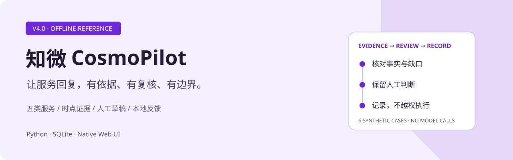
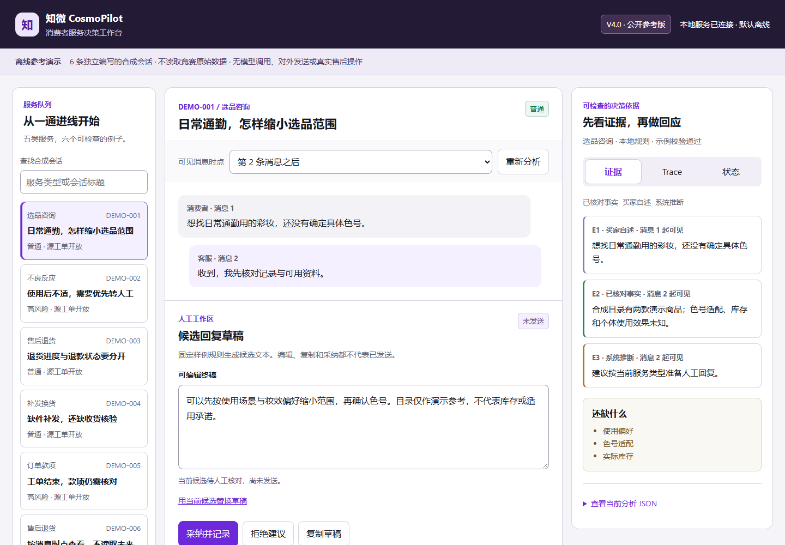

<picture>
  <source media="(prefers-color-scheme: dark)" srcset="docs/assets/cover-dark.svg">
  
</picture>

# CosmoPilot · V4.0

An offline public reference for evidence-led consumer service and human-reviewed drafts.

[中文](README.md) · [Portfolio](https://github.com/Daniel-24-life/AIfile)



This repository reconstructs selected product mechanisms from the V4.0 specification. The interface, code and six synthetic conversations were prepared for public use. It is not an export of the original competition project or a claim that the later V4.1 working tree is V4.0.

## Run

Python 3.11+; standard library only. No model key, package installation or frontend build is required.

```sh
python -B app.py
```

Open <http://127.0.0.1:4188>. Use `--port 4190` for another port and `--db .runtime/another.sqlite` for an isolated local state file. Stop with Ctrl+C.

## Explore

- `DEMO-001`: separate verified synthetic records, consumer statements, inferences and missing information.
- `DEMO-002`: high-risk review checks, editable drafts and invalidation after edits.
- `DEMO-006`: compare message cutoffs without leaking later evidence into an earlier view.

The six cases cover product consultation, adverse-reaction routing, returns, replacements and payment questions. They do not provide personalized medical advice or execute service actions.

## Engineering

Native HTML/CSS/JS calls a loopback-only Python server. SQLite persists analyses, context identifiers, feedback and idempotency results. Draft feedback distinguishes unchanged adoption, edited adoption and rejection. A stale analysis cannot be adopted after its context changes. Local adoption never marks a source ticket closed or a reply sent.

The six-step trace measures actual local computation, not model reasoning or production performance. Draft checking uses a deliberately small illustrative rule set, not a complete safety verifier.

## Verification

```sh
python -B -m unittest discover -s tests -v
node --check web/app.js
```

Node.js 22+ is only for syntax checks and optional browser QA. The workbench itself needs Python only.

Chinese deep-dive documents: [architecture](docs/architecture.md), [AI Coding and team roles](docs/ai-coding.md), [source reading](docs/source-reading.md), [verification](docs/VERIFICATION.md), [UI QA](docs/UI_QA.md), [public scope](docs/public-scope.md), [provenance](docs/provenance.md).

The original project was collaborative: product, visual design, acceptance and frontend coordination were the author's responsibilities; technical teammates primarily handled data, models and backend integration. AI-assisted implementation is not presented as independent AI authorship or sole ownership of the original team project.

No original competition data, official assets, private logs, credentials or production execution chains are included. No model calls, official endorsement, competition ranking, or production outcome is claimed. No license is added in this release.
