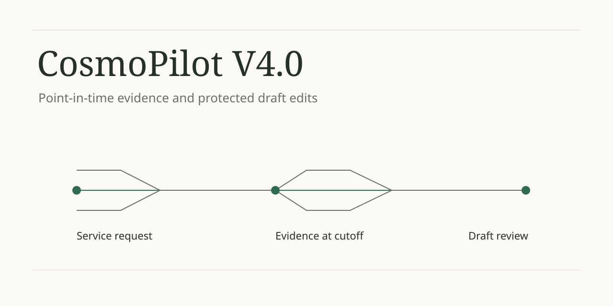
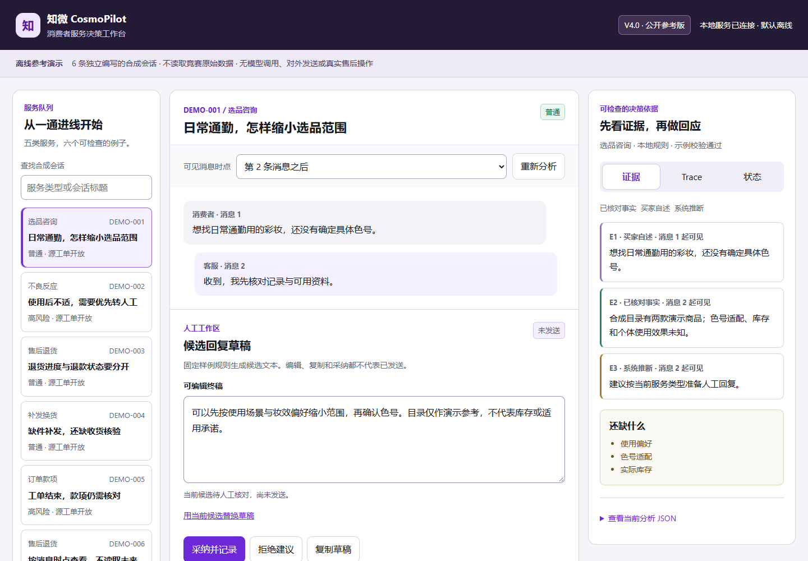

<picture>
  <source media="(prefers-color-scheme: dark)" srcset="docs/cover-dark.svg">
  <source media="(prefers-color-scheme: light)" srcset="docs/cover-light.svg">
  
</picture>

# CosmoPilot V4.0

An offline consumer-service workbench that brings conversation evidence, draft review, and local feedback into one view.

[中文说明](README.zh.md) · [Portfolio](https://github.com/Daniel-24-life/portfolio)



## What it demonstrates

- Inspect the evidence available at a selected point in a conversation.
- Revise a response draft and repeat its review when the content changes.
- Record approval, revision, or rejection in a local SQLite database.

**Stack** · Python standard library, SQLite, HTML, CSS, JavaScript

## Repository layout

| Path | Contents |
| --- | --- |
| [`app.py`](app.py) | Local HTTP server |
| [`core.py`](core.py) | Evidence, draft review and feedback logic |
| [`web/`](web/) | Workbench interface |
| [`samples.py`](samples.py) | Synthetic conversation fixtures |
| [`tests/`](tests/) | Reference behavior checks |

## Run locally

```sh
python -B app.py
python -B -m unittest discover -s tests -v
```

Open the local address printed by the server. Start the test command in a separate terminal.

## Scope and limits

This repository independently reconstructs selected V4.0 mechanisms with synthetic sessions. Approval records local feedback. It grants no authority to send messages, issue refunds, or change source tickets. The original project was developed by a team. Daniel led product, interface, and acceptance work and coordinated the frontend implementation.

[Architecture](docs/architecture.md) · [Provenance](docs/provenance.md) · [Public scope](docs/public-scope.md)
