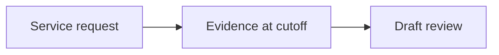

<picture>
  <source media="(prefers-color-scheme: dark)" srcset="docs/cover-dark.svg" />
  <source media="(prefers-color-scheme: light)" srcset="docs/cover-light.svg" />
  
</picture>

# CosmoPilot V4.0

Put point-in-time evidence, editable drafts, and review decisions in one service workbench.

[▶ Demo](#demo) · [中文](README.zh.md) · [](https://github.com/Daniel-24-life/cosmopilot-v4/actions/workflows/verify.yml) · [MIT](LICENSE) · Python 3.11+

## Demo


## Problem

Treating a whole conversation as one snapshot can leak information from a later message into an earlier decision. Operators also need control over the draft they are editing.

## What I built

- Inspect evidence available at the selected conversation cutoff.
- Keep operator edits intact across analysis updates.
- Route sensitive cases to a human review step.
- Record a review decision in SQLite.

## How it works



## Run in 60 seconds

```sh
python -B app.py
```

Once the local server starts, open [http://127.0.0.1:4188/](http://127.0.0.1:4188/).

## Tests

**25 tests passed.** [Verified GitHub Actions run](https://github.com/Daniel-24-life/cosmopilot-v4/actions/runs/45105682672).

```sh
python -B -m unittest discover -s tests -v
```

## Repository layout

| Path | Contents |
| --- | --- |
| [`app.py`](app.py) | Local HTTP entry point |
| [`core.py`](core.py) | Evidence and review rules |
| [`web/`](web/) | Service workbench |
| [`samples.py`](samples.py) | Scenario fixtures |

Reference material · [architecture.md](docs/architecture.md) · [source-reading.md](docs/source-reading.md) · [VERIFICATION.md](docs/VERIFICATION.md)

<sub>Demo data is synthetic; modeled on real-world workflows. This V4.0 reference was reconstructed from a team project. Review decisions stay in the local demo database, and sending messages or modifying source tickets is outside its scope.</sub>
