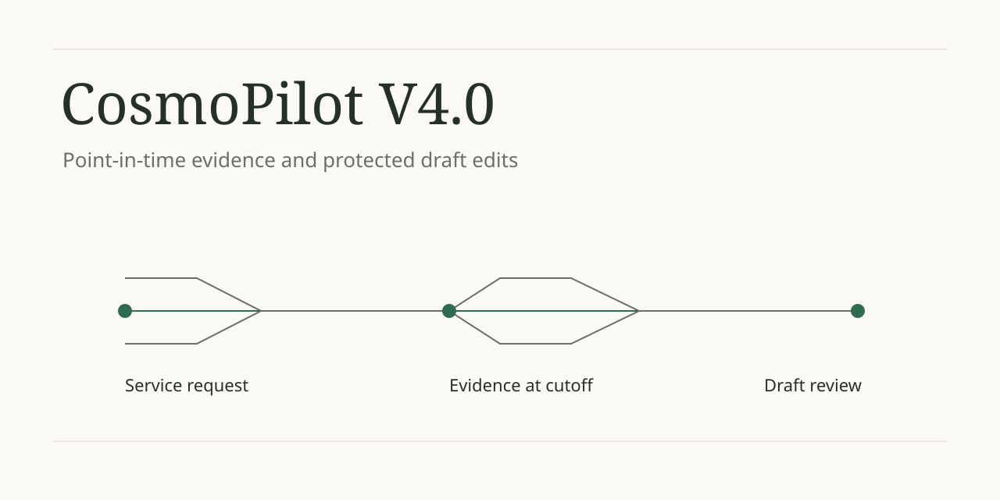
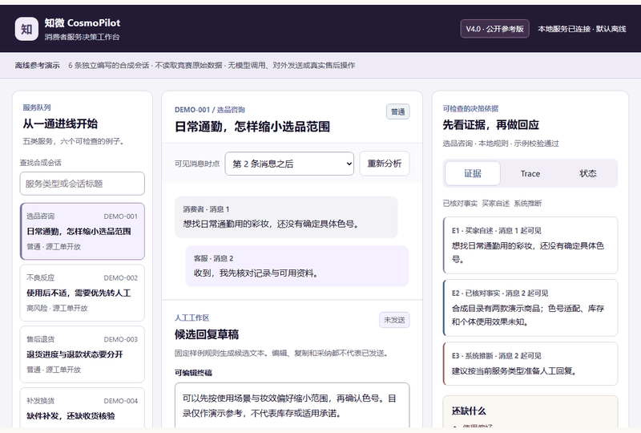
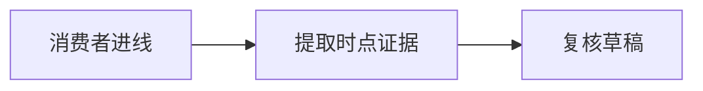

<picture>
  <source media="(prefers-color-scheme: dark)" srcset="docs/cover-dark.svg" />
  <source media="(prefers-color-scheme: light)" srcset="docs/cover-light.svg" />
  
</picture>

# CosmoPilot 消费者服务台

在同一个客服工作台查看当时可见的证据、编辑草稿和登记复核决定。

[查看演示](#demo) · [English](README.md) · [](https://github.com/Daniel-24-life/cosmopilot-v4/actions/workflows/verify.yml) · [MIT](LICENSE) · Python 3.11+

## Demo



## 要解决的问题

客服需要知道决定当时已经看到哪些信息。切换分析时点也需要保住已经人工改过的草稿。

## 实现

- 按会话时点查看证据和缺口。
- 保护人工编辑的草稿。
- 把复核决定写入本地 SQLite。

## 工作流程



## 快速运行

```sh
python -B app.py
```

启动后打开 [http://127.0.0.1:4188/](http://127.0.0.1:4188/)。

## 测试

实测 **25 项通过**。[通过的 GitHub Actions 运行](https://github.com/Daniel-24-life/cosmopilot-v4/actions/runs/45105682672)。

```sh
python -B -m unittest discover -s tests -v
```

## 仓库目录

| 路径 | 内容 |
| --- | --- |
| [`app.py`](app.py) | Local HTTP entry point |
| [`core.py`](core.py) | Evidence and review rules |
| [`web/`](web/) | Service workbench |
| [`samples.py`](samples.py) | Scenario fixtures |

延伸阅读 · [architecture.md](docs/architecture.md) · [source-reading.md](docs/source-reading.md) · [VERIFICATION.md](docs/VERIFICATION.md)

<sub>V4.0 是对团队项目机制的公开重建。示例进线为合成数据，复核记录存入本地演示数据库。</sub>
